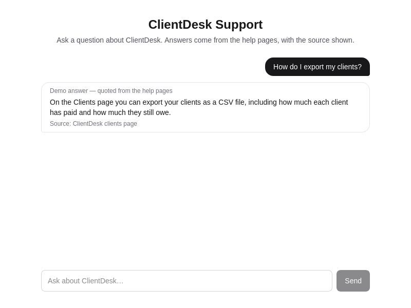

# ClientDesk Support Agent

A support agent for [ClientDesk](https://github.com/MuhammadAhmad67889/clientdesk) users. Ask a question, get an answer quoted from the real help pages with its source. When the agent cannot answer, it says so and offers a ticket — a human picks it up in the admin inbox.

Live demo: https://clientdesk-support.vercel.app



## What it does

- **Chat** (`/chat`) — asks the knowledge base and answers with citations. Suggested questions included; embeddable on any page with `public/widget.js`.
- **Demo mode (default, no key)** — the answer is the matching help passage, quoted word for word. It generates no text.
- **Live mode (Groq, needs a key)** — a real answer grounded in the retrieved passages. The model is told to answer only from those passages, and any source it names that was not in the passages is dropped.
- **Tickets** — "Still stuck? Open a ticket for a human" turns a conversation into a ticket with the full transcript. Tickets opened after an unanswered question are marked escalated.
- **Admin inbox** (`/admin`) — open tickets first, full transcript, human replies (the user sees them when they reopen the chat), mark resolved.
- **Analytics** (`/admin/analytics`) — questions, answer rate, top questions, and the questions the agent could not answer (those are the gaps in the help pages).
- **Scripted evals** (`/admin/evals`) — 8 fixed questions with expected sources, run through the agent in demo mode, pass/fail recorded.

## Honest rules

- The knowledge base (`src/lib/kb.ts`, 16 passages) is built only from real ClientDesk facts: the free plan is 10 clients / 30 invoices; Pro $9 and Business $19 are planned but billing is not set up, so nobody can pay yet; password reset and Google/GitHub sign-in are built but not switched on; demo data is 3 clients + 5 invoices.
- The agent never invents. If nothing matches, it says so.
- An opened ticket is never counted as answered.
- There is **no login on the admin pages in v1** — protect `/admin` (Vercel Deployment Protection, or auth) before sharing the app widely.

## Run it locally

```bash
npm install
npm run dev
```

Needs a Postgres database for conversations, tickets, analytics, and evals:

```bash
cp .env.example .env   # fill in DATABASE_URL
npm run db:generate
npm run db:migrate     # applies the migrations
npm run db:seed        # 16 knowledge base passages + 8 eval scenarios
```

The chat answers work without a database — storage is best-effort, so if the database is down the question is still answered (the conversation just is not saved).

```bash
npm test        # vitest (55 tests)
npm run lint
npx tsc --noEmit
npm run build
```

## Live answers (optional)

```bash
GROQ_API_KEY="..."   # free key from https://console.groq.com
# GROQ_MODEL="llama-3.3-70b-versatile"  # the default
```

Without the key the app runs in demo mode. Live answers are verified with mocked API calls in the tests, not against the real Groq API (no key in the repo).

## Deploy

Vercel, from this repo. Set `DATABASE_URL` (a Neon Postgres database works) and, for live answers, `GROQ_API_KEY`. The build runs `prisma migrate deploy` first (see `vercel.json`), so the tables exist before the app starts. The knowledge base seed runs in CI against its own Postgres; on a fresh live database, run `npm run db:seed` once with the live `DATABASE_URL` to fill the passages and eval scenarios tables (the chat reads the passages from code, so it works before the seed too).

## Where it stands

**M1–M6 done.** M1: knowledge base + keyword search. M2: chat + demo responder + widget. M3: live Groq provider. M4: tickets + admin inbox. M5: analytics + scripted evals. M6: this README, screenshots, and the live deploy.

## Stack

Next.js 16 + TypeScript (strict) + Tailwind v4 + Prisma 6 + Postgres. Prisma is pinned to 6.19.3 — the npm latest (8 RC) restructured the CLI and has no `generate`/`migrate` commands. Tests run in Vitest (node env); the database-backed paths are tested with a mocked Prisma client, and the real database path runs in CI (postgres service) on every push.

## Code style

Small functions with clear names, comments only where they explain why, plain wording, no clever one-liners. A bug should be easy to trace.
